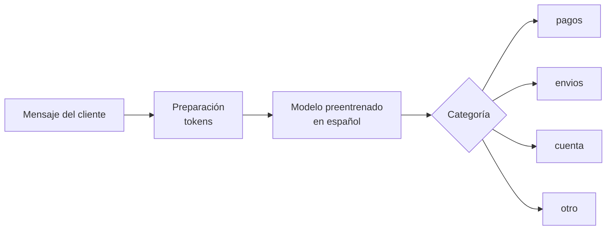

<div align="center">

# 📬 Clasificador de reclamos de clientes

**Un modelo de lenguaje que lee los mensajes de los clientes y los envía al equipo correcto.**


[](https://colab.research.google.com/github/TU_USUARIO/clasificador-reclamos/blob/main/notebooks/01_linea_base.ipynb)

*Proyecto del curso Estud-IA · Capa 2 · IA nivel intermedio*

</div>

---

## 📌 Contenido

1. [El problema](#-el-problema)
2. [La solución](#-la-solución)
3. [El error que más importa](#-el-error-que-más-importa)
4. [Datos](#-datos)
5. [Metodología](#-metodología)
6. [Resultados](#-resultados)
7. [Cómo ejecutarlo](#-cómo-ejecutarlo)
8. [Estructura del repositorio](#-estructura-del-repositorio)
9. [Límites conocidos](#-límites-conocidos)
10. [Hoja de ruta](#-hoja-de-ruta)
11. [Uso responsable de IA](#-uso-responsable-de-ia)

---

## 🎯 El problema

El equipo de soporte de una tienda en línea recibe cientos de mensajes al día. Hoy un analista los lee uno por uno para decidir a qué equipo corresponde cada caso. Eso toma tiempo, y los reclamos urgentes pueden quedar enterrados entre las consultas simples.

> **Escenario ficticio.** No es una tienda real ni hay información de personas reales.

## 💡 La solución

Un clasificador de texto que lee cada mensaje y devuelve su motivo:

| Categoría | Qué incluye | Ejemplo |
|---|---|---|
| 💳 `pagos` | Cobros, reembolsos, facturas, medios de pago | «Me cobraron dos veces el mismo pedido» |
| 📦 `envios` | Entregas, rastreo, dirección, producto dañado | «Mi pedido debía llegar el lunes y no aparece» |
| 🔐 `cuenta` | Acceso, contraseña, verificación, datos del perfil | «Alguien entró a mi cuenta y hizo compras» |
| 💬 `otro` | Preguntas generales, sugerencias, felicitaciones | «¿Cuál es el horario de sus tiendas?» |

**Usuario final:** analista de soporte de una tienda en línea.



## ⚠️ El error que más importa

No todos los errores cuestan lo mismo.

| Error | Gravedad | Por qué |
|---|---|---|
| Un reclamo **urgente de pagos** clasificado como `otro` | 🔴 Alta | El cliente queda sin respuesta y el problema crece |
| Una consulta general clasificada como `pagos` | 🟡 Baja | Se corrige al leerla, solo se pierde tiempo |

Por eso **no basta con medir el acierto global**. Este proyecto reporta específicamente cuántos pagos (y pagos urgentes) se van a `otro`.

## 🗂️ Datos

| Característica | Detalle |
|---|---|
| **Tipo** | Texto en español |
| **Origen actual** | Sintético (ficticio) |
| **Tamaño actual** | 298 mensajes |
| **Balance** | 25 mensajes base por categoría, con 3 variantes cada uno |
| **Archivo** | [`datos/mensajes_sinteticos.csv`](datos/mensajes_sinteticos.csv) |
| **Generador** | [`src/generar_datos.py`](src/generar_datos.py) (semilla fija 42) |

**Columnas:**

| Columna | Descripción |
|---|---|
| `id` | Identificador del mensaje |
| `mensaje` | Texto escrito por el «cliente» |
| `categoria` | `pagos`, `envios`, `cuenta` u `otro` |
| `urgente` | `si` o `no`, para medir el error que más importa |
| `origen` | `sintetico` (se usará `publico` al sumar datos externos) |
| `grupo` | Mensaje base del que salió la variante |

**Variantes de cada mensaje base:** original, con saludo y cierre, y sin tildes ni signos. Así el modelo ve mensajes formales e informales.

> 🔒 **Privacidad:** todos los mensajes fueron escritos para este proyecto. No hay nombres, teléfonos, correos ni números de pedido reales.

## 🔬 Metodología

1. **División por grupo.** Las variantes de un mismo mensaje base siempre quedan juntas, en entrenamiento o en prueba. Si se dividiera al azar, una variante de prueba tendría a su gemela casi idéntica en entrenamiento y el acierto saldría inflado (*fuga de datos*).
2. **Línea base sin ajustar.** Se mide un modelo preentrenado sin entrenamiento específico: `MoritzLaurer/mDeBERTa-v3-base-mnli-xnli` en modo zero-shot.
3. **Ajuste con LoRA** *(próxima etapa).* Se adapta un modelo preentrenado en español cambiando solo una parte pequeña de sus pesos.
4. **Comparación reproducible.** Mismo conjunto de prueba, misma semilla y mismas métricas para ambos modelos.

**Métricas:**

- Acierto global, precisión, recall y F1 por categoría.
- Matriz de confusión.
- Pagos (y pagos urgentes) enviados a `otro`.

## 📊 Resultados

> Se completa al ejecutar los notebooks.

| Modelo | Acierto | F1 macro | Pagos → `otro` | Pagos urgentes → `otro` |
|---|---|---|---|---|
| Línea base (sin ajustar) | _pendiente_ | _pendiente_ | _pendiente_ | _pendiente_ |
| Ajustado con LoRA | _pendiente_ | _pendiente_ | _pendiente_ | _pendiente_ |

**Observaciones:** _pendiente._

## 🚀 Cómo ejecutarlo

### Opción A: Google Colab (recomendada)

1. Pulsa el botón **Abrir en Colab** de arriba.
2. Ejecuta las celdas en orden con `Shift + Enter`.
3. Cuando se pida, sube `datos/mensajes_sinteticos.csv`.

### Opción B: en local

```bash
git clone https://github.com/TU_USUARIO/clasificador-reclamos.git
cd clasificador-reclamos
pip install pandas scikit-learn matplotlib transformers torch
jupyter notebook notebooks/01_linea_base.ipynb
```

### Regenerar los datos sintéticos

```bash
python src/generar_datos.py datos/mensajes_sinteticos.csv
```

## 📁 Estructura del repositorio

```
clasificador-reclamos/
├── README.md
├── datos/
│   └── mensajes_sinteticos.csv
├── notebooks/
│   └── 01_linea_base.ipynb
└── src/
    └── generar_datos.py
```

## 🚧 Límites conocidos

- **Datos sintéticos.** Los mensajes reales son más desordenados, más largos y más variados.
- **Estilo uniforme.** Los mensajes base los escribió una sola persona, así que se parecen entre sí.
- **Prueba pequeña.** El conjunto de prueba tiene unos 59 mensajes (solo 9 de `cuenta`). Las métricas son orientativas.
- **Cuatro categorías.** Un mensaje con dos problemas a la vez solo recibe una etiqueta.
- **No es un sistema en producción.** Es un prototipo de aprendizaje.

## 🗺️ Hoja de ruta

- [x] Definir el problema, las categorías y el error clave
- [x] Crear dataset sintético y script generador
- [x] Preparar notebook de línea base
- [ ] Ejecutar la línea base y registrar resultados
- [ ] Sumar un dataset público en español (con licencia revisada)
- [ ] Ampliar a ~300 mensajes mezclando públicos y sintéticos
- [ ] Ajustar con LoRA y comparar contra la línea base
- [ ] Analizar errores y documentar lo aprendido
- [ ] Desplegar el modelo como servicio interno

## 🤖 Uso responsable de IA

- Parte de los mensajes sintéticos se redactó con apoyo de IA. **Todos se revisaron manualmente** antes de usarse.
- Las respuestas de IA se tratan como borradores: se ejecutan, se comparan con los datos y se explican con palabras propias.
- Los datos son ficticios o de licencia permitida. No se usan claves ni información personal.

---

<div align="center">

Hecho con 🧡 en el curso **Estud-IA** · Autor: _TU NOMBRE_

</div>
